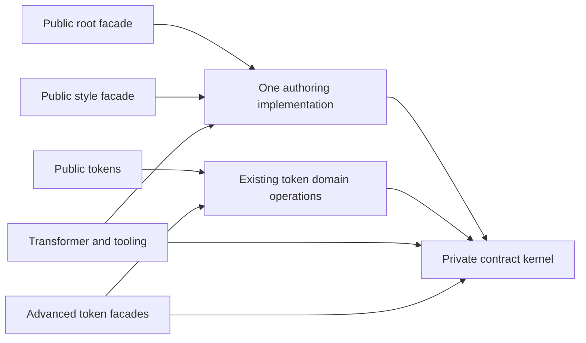

# M10.5 private pure-contract kernel design

Date: 2026-10-17. Status: **proposed; written review required**. Design base: `8adba6a`.

This document delivers the approved design task. It authorizes no prototype, implementation plan execution, dependency change, performance exception or release. The [proposed ADR](../../decisions/stage-a-private-compiler-free-contract-kernel.md) records the architectural choice; [M10.5](../../roadmap.md) records delivery. The existing consumer-scoped release policy remains unchanged.

## Intent and recommendation

Give ordinary token code and native authoring a compiler-free contract boundary with canonical bindings. Use an explicit private JavaScript artifact rather than relying on a chunk-group heuristic to preserve that boundary. Test a concrete performance hypothesis before considering this layout as a release remediation.

The [recursive grouping candidate](../../evidence/2026-10-17-m10-5-fresh-pipeline-remediation/README.md) leaked Vanilla Extract into token imports. The [entry-aware proof](../../evidence/2026-10-17-m10-5-entry-aware-packaging-proof/README.md) preserved the import boundary but changed pure chunk names beyond the runtime source allowlist, gave no file-count consolidation, and stopped before identity or timing. Both attempts remain closed; no subset is admitted here.

**Recommendation:** prefer the staged kernel as the next precisely specified structural hypothesis. Current evidence does not support expecting it to close the release performance gap. Written-design approval can lead to a separate single-candidate feasibility plan; it is not a commitment to prototype or ship. If safe consolidation has insufficient independent value, park this design as release remediation before spending on another prototype.

## Exact kernel boundary

“Pure” means free of compiler, platform and third-party runtime dependencies. It does **not** mean referentially pure or free of initialization effects. `theme-token.ts` currently initializes shared registry state; preserve that implementation and protocol.

| Existing source module | Runtime dependencies inside the cut | Responsibility |
| --- | --- | --- |
| `src/diagnostics.ts` | None | Diagnostic codes and formatting |
| `src/tokens/identity.ts` | None | Contract identities, token/path/signature encoding |
| `src/theme-token.ts` | Diagnostics and identity | Token metadata, contract ownership, existing registry protocol |
| `src/theme-contract.ts` | Diagnostics and theme-token | Contract creation, theme values and token access |
| `src/tokens/domain-values.ts` | None | Literal domain admission, normalization and equality |

Introduce a private source facade at `packages/css/src/internal/contract-kernel.ts` containing direct re-exports of the existing runtime bindings from exactly these five modules. Their 40 current runtime export names do not conflict (verified by type-erased source analysis, not a build). Do not copy implementations, create forwarding functions, or add new services. A build membership receipt must contain only the five modules plus this export-only facade; synthetic format glue must be identified separately and cannot load a builtin or package. Every existing runtime export from the five modules is available to the internal linker, including registry accessors needed by tooling. They are not new supported public exports.

Keep `tokens/domains.ts` outside: its full token/theme operations are not required by style and would enlarge the style closure. Keep schema/value/codec modules, authoring, native capture, components, expressions, React, React Native and Effect outside. The type-only `domain-values` → `tokens/domains` reference remains available to declarations but creates no JavaScript dependency.

Emit one private file per format, `dist/theme-contract-kernel-<sha256>.mjs` and `dist/theme-contract-kernel-<sha256>.cjs`, where each digest is computed from the complete actual emitted bytes of that format. The full content digest is part of the literal import path; it is not a timestamp, source-only digest or constant name. Use existing runtime dependency policy, target `node22`, minification consistent with the current tool build, disabled code splitting and no Node shim. Require zero runtime externals and zero `node_modules` membership. The name belongs to the existing `theme-contract-*` provenance family and must describe the real audited kernel. The existing source-list guard stays unchanged; naming alone is not evidence of purity. The package export map stays unchanged, so consumers acquire no new supported subpath.

## Canonical ownership and runtime isolation

This diagram describes the existing combined **tool entry family**, per format. Root/style/tokens, Metro, transformer and relevant advanced/tooling imports resolve kernel bindings to that one artifact. Keep all other tool-family modules in their existing combined build graph: a separately compiled authoring facade could duplicate helpers/classes used by transformer/tooling. The authoring capsule is produced within the combined graph, after the kernel cut is externalized.

The separately configured compatibility/focused theme group, core, token-only runtime, extension, algebra, motion/native motion, container and devtools builds remain independent. Do not redirect their source modules into this kernel or unify their build graphs. Their current provider/resolver binding relationships and cross-copy interoperability remain required.

Within ESM and within CJS, all genuinely shared root/style bindings retain strict equality, including functions, objects and tags. Direct re-exports preserve live bindings; wrappers and independent rebuilds do not. Do not invent a root `componentRecipe` export. Do not require ESM functions to equal CJS functions, or new equality between intentionally separate build groups. Instead verify their existing registry/provider behavior in both import orders and formats.

Preserve the four `Symbol.for` registry keys, existing descriptors, collision checks, WeakMap/Map ownership, local-terminal-domain behavior, and serialized identities. Existing VM evaluation still creates its existing realm; no global registry is moved across realms or cached between authoring requests. Characterize observable initialization/error order against the control, including mixed entry loading. Any newly observed consumer-visible initialization regression rejects the candidate; do not replace eager initialization with lazy registration to conceal it.

## Staged build and linking mechanism

Installed tsdown 0.21.10 exposes public `build(InlineConfig): Promise<TsdownBundle[]>`; installed Rolldown 1.0.0-rc.17 exposes per-format input/output callbacks, ordered `resolveId`, `this.resolve(..., {skipSelf:true})`, `external: "relative"`, and disabled code splitting. These are inspected installed APIs, not a tested prototype. tsdown launches a configuration array with `Promise.all`, so array order cannot establish the kernel prerequisite. Do not use its explicitly private `buildWithConfigs` API.

Use an explicit Node-hosted package build driver at `packages/css/build.mjs`:

1. Resolve the package root, requested build mode and output directory. The driver owns cleanup exactly once, preserving the existing `CRUMBS_CSS_SKIP_CLEAN=1` behavior for `build:dev`. Remove only generated outputs owned by this package; do not follow a destination symlink into another tree.
2. Await public `build` with dedicated `tsdown.kernel.config.ts`, emitting raw kernel outputs into an owned temporary stage directory. Verify the exact member/export set, zero externals, both formats and one chunk per format. Hash the actual bytes with SHA-256 and publish the two content-addressed files into the destination. Write a generation-scoped, build-only manifest in that owned temporary directory with exact format/path/digest and source-membership facts. Kernel outputs are complete before any tool build starts.
3. Await public `build` for the existing config family. Supply the manifest path through driver-only `CRUMBS_INTERNAL_KERNEL_MANIFEST` while the tool configuration loads; validate its generation, exact format/path/digest, current source membership and destination before creating frozen linker parameters. Do not scan for the newest matching filename: skip-clean mode may retain older hashes. All configurations, including DTS, use `clean:false`; a later declaration clean must not erase the kernel. Independently configured runtime graphs keep their current entries/policies. Only tool JavaScript receives the linker and remaining-authoring grouping.
4. Finish the existing single source-based declaration build and `.d.cts` re-export stubs. Check both selected kernel files/digests and every expected public target before reporting success. Restore the prior internal environment value and dispose the owned stage/manifest in `finally` on success or failure. The manifest, generation ID and temporary paths are not packaged or imported by consumer code. Retain their qualification receipts separately.

Normal `build`, `build:dev` and `prepack` route through this driver; root workspace commands keep their existing purpose. No new runtime dependency, CLI user option, authoring setting, installation requirement or public feature flag is added. Dedicated kernel configuration and the generation-scoped manifest handoff are internal packaging machinery; the internal environment variable is not a supported user setting. Watch/service orchestration is outside this design. A failed stage returns failure and prevents packing/publication; this does not introduce an atomic live replacement guarantee for a dev `dist` tree, which the current build also does not provide.

For tool JavaScript only, create the linker through `inputOptions(options, format, context)`, using the normalized mapping `es → .mjs`, `cjs → .cjs` to select the exact manifest-owned artifact. Resolve each import through the normal resolver with `skipSelf:true`; compare its canonical real path with the exact five-source allowlist. Return the absolute same-format emitted kernel path with `external:"relative"`, so output imports are literal relative artifact edges. Unrelated modules, another package copy, virtual IDs and the private source facade itself must not match. Fail unexpected duplicate implementations through membership checks; do not widen matching by basename, directory or suffix. Unexpected formats fail rather than selecting a fallback.

The linker applies neither during the kernel build nor during DTS. It leaves aliases, conditions and normal dependency resolution unchanged for every other import. After this cut, recursively group the remaining native-style closure into one `crumbs-authoring` chunk within the existing tool graph. Kernel externals are not pulled into that group. Ordinary token facades must reach only their domain operations/kernel, never this authoring chunk.

Use literal relative paths from emitted files; reject leaked absolute build paths, source `.ts` paths, pseudo module IDs, computed loaders, self-package bare imports and CJS → ESM edges. The private files are included by the existing `dist` package file rule. Do not publish a kernel-only package or require consumers to install anything new.

## One canonical declaration graph

Keep the current public source entries together in the single DTS build. Do not rewrite type imports to emitted kernel JavaScript, add a second kernel declaration source, duplicate unique-symbol declarations or expose the private facade as a public type entry. Preserve the type-only cycle and existing generic/nominal contract sites. Kernel JavaScript and consumer declaration identity are separate proof obligations.

## Concrete performance hypothesis

H1, structural: with the public style facade retained, the observed library closure becomes **at most three ESM files** (facade + authoring capsule + kernel) and **at most four CJS files** (plus the existing shim if separate). Actual input inventories must show five fewer library module boundaries with no duplicated kernel bodies. The authored fixture files and all other required inputs remain. Current ESM fixture observations include ten total inputs; this predicts five only for those same fixtures if the two authored inputs remain unchanged. It is not a global five-input guarantee.

| Current style closure | ESM | CJS |
| --- | ---: | ---: |
| Four shared helper chunks | 14,466 B | 16,983 B |
| Three authoring implementation chunks | 61,810 B | 66,994 B |
| Public style facade | 2,403 B | 2,459 B |
| Separate CJS shim | — | 554 B |
| Total | 78,679 B / 8 files | 86,990 B / 9 files |

The [retained control graph](../../evidence/2026-10-17-m10-5-fresh-pipeline-remediation/build-before.json) supplies these numbers. Packaging the same function bodies together removes some resolution/read/module-bookkeeping boundaries and possibly import/export glue. **No functional body bytes, validation, lowering, CSS conversion or authored evaluation are established as removable.** Full internal export retention can increase parsed bytes; record that risk rather than assuming a byte saving.

Each transform still performs fresh Vanilla Extract/esbuild compilation with `bundle:true`. The kernel is compiled once during **package construction**, then parsed/bundled again as an input of every fresh authoring transform. The layout does not add an esbuild externalization override, compiled-text memo, persistent context or authoring export cache. Ordinary `.mjs` helper chunks do not receive the integration plugin's CSS-only file-scope/debug-ID transformation, so merging them does not eliminate that authored CSS/Babel work.

H2, end-to-end: after behavior and H1 pass, the unchanged complete warm selector meets both existing bounds:

| Exact retained release comparison | Value |
| --- | ---: |
| Historical warm baseline | 5.664125000000013 ms |
| Absolute ceiling | 6.514 ms |
| Relative ceiling, baseline × 1.15 | 6.513743750000014 ms |
| Effective ceiling | 6.513743750000014 ms |
| Failed final-tag selector | 12.346250000000055 ms |
| Saving needed from that result | 5.832506250000041 ms / 47.2411157% |

These are requirements and arithmetic from the [unchanged final report](../../evidence/2026-10-17-m1-10c-expo58-release/final-release/host-report/comparison.json), not an expected effect size or a matched new control/candidate result. The existing comparator, not copied rounded constants, decides a future pass.

The [fresh compiler diagnosis](../../evidence/2026-10-17-m10-5-v12-fresh-compiler-diagnosis/README.md) identifies fresh compilation as a large boundary but supplies no causal estimate for these five module boundaries. Its synchronous-read probe misses esbuild-native and asynchronous reads and does not measure the proposed kernel. Nested phase medians, old profiles and build times cannot be added/subtracted to predict a full-transform result. **Current evidence supports H1 as plausible; it does not support expecting H2.** Keep the kernel parked as a promised release fix unless a future explicitly approved proof demonstrates H2.

## Qualification order for a later separately approved proof

A written implementation/feasibility plan must preserve one complete candidate and the following stop order. No test or build in this section ran during this design task.

1. **Control:** use immutable v1.2.0 source and the retained exact tarball SHA-256 `4bd7897aa5beb6383b158f4e214436ba5d0d659b6b0fc005142c945a10dda02e`, independently placed from candidate. Verify installed bytes, source/fixtures, lockfile/tool/environment identities and control/control agreement. Neighboring rebuilt dist is not a control.
2. **Structure first:** verify kernel membership/zero externals, one same-format artifact owner, no duplicate five-source implementations in the tool graph, H1 counts, normal clean and skip-clean rebuilds, all 59 package export rows, all 30 ordinary-runtime source-list guards, literal format-correct links and no private public subpath. Inject direct and transitive Node/Vanilla Extract/Effect contamination and a wrongly named/grouped runtime chunk as rejecting controls. No guard/allowlist change is part of this candidate.
3. **Identity and declarations:** actual Node 22.0.0 and current Node, packed ESM/CJS in both root/style orders; compare the actual shared export set. Deny compiler/builtin loading at all ordinary entries, preserving only approved runtime peers. Check existing theme/focused provider-resolver identities and mixed ESM/CJS cross-copy registry/collision behavior. Compile existing primitive/token nominal fixtures and cross-entry assignments through unchanged consumer export conditions.
4. **Behavior:** retain strict native output/value/descriptor/ordering/freezing/error contracts, source-map anchors in direct/top-level/nested Babel/Rust maps, authored dependency/resolution witnesses, fresh ambient/counter evaluation, and entry/dependency error/edit/restore behavior. An immutable control install need not share function/symbol identity with candidate. Record real candidate library artifacts and their hashes as intentionally changed inputs. Do not copy control receipts or require fake equality of different private layouts.
5. **Cache proof:** keep the existing marker algorithm and metadata schema. Independently derive the resolution key as the current SHA-256 of `JSON.stringify({ entryHash, inputs: capturedInputs, resolutionIdentity })`, then feed it, the unchanged context/compiler key and authored dependency hashes to the existing dependency-cache function. The current recipe does not hash compiled source text. Verify unchanged-input determinism and exact edit/restore stability. Precisely identify intentional private artifact/path changes. Only the justified opaque marker difference may be aligned in final generated code; maps/authored outputs cannot be normalized wholesale. No new fingerprint algorithm, AST ownership optimization or removed capture callback belongs here. In compiled ESM and CJS, a deliberately observable equal-length kernel-only edit must change the actual loaded-kernel path/digest, the owning transformer file hash returned by `getCacheKey`, native output and marker; exact restoration must restore all of them. Prove the selected content-addressed path propagates into that actual hashed transformer implementation, directly or through content-addressed imports. A hashed kernel name alone is insufficient. Run each version in a fresh process, then separately retain existing restart/edit contracts; this proof adds no claim that an already loaded Node module refreshes without a restart. Reject the layout if compiler identity cannot follow kernel content without changing the cache algorithm.
6. **Warm feasibility:** run the existing `bench/native-styles.bench.ts` from each complete scratch package with unchanged source/fixtures and candidate dist selected by package self-resolution. Use package-root warm cwd, six retained one-operation observations per fixture after its existing setup/warmup, and five serial fresh uninstrumented Bun processes. Keep all raw samples/reports and min/median/max. The existing selector takes each process's worse fixture nearest-rank p50, then the median of the five maxima. No instrumentation process, compiled-CJS pilot or pooled selector substitutes for it. Require both unchanged limits and all required process reports.

Stop at the first failed prerequisite. If H1 fails, do not tune a second layout. If identity/parity fails or H2 fails either bound, archive and remove the whole candidate; the kernel does not ship as a partial improvement. No warm failure falls through to a retained compiler service, further grouping variants or expensive release replay. Better architecture alone would require a separate adoption decision after a failed performance proof.

If all feasibility conditions pass, a single complete production admission plan must additionally cover the appropriate full suite, type/build/docs/packed checks, SDK56/57/58, real Babel/Rust/native software contexts and a fresh exact-source host report. All 11 blocking release rows must pass with zero invalid/incomplete evidence; all 10 advisory results remain recorded. Warm success alone leaves cold/incremental admission unresolved. Physical hardware, spoken-reader checks, iOS27/DeviceHub and release FPS remain deferred.

## Affected paths and boundaries for the later plan

- New private facade, kernel build configuration, linker and Node build driver under `packages/css/`; these are build-time boundaries, not consumer APIs.
- `packages/css/tsdown.config.ts`, `build-policy.ts` and `package.json` build commands. No export-map, runtime dependency, engine, lockfile or public declaration contract change. The driver-only manifest channel must never become a consumer option or leak into emitted code.
- Existing build/isolation/packed, token identity, provider/registry and primitive/type tests; a new focused build-order/link/membership test and real root/style binding comparison. Existing auditors remain authoritative.
- Existing benchmark/host selectors and registry stay unchanged. An owned qualification helper and evidence packet may orchestrate them after approval; it must not add instrumentation to a timing process.

Implementation order and exact commands belong to the next written plan after spec review. Any admitted production change has a new source/artifact identity and normal next release-please version, expected 1.2.1. The immutable GitHub v1.2.0 tag, its three failed host metrics, the lack of a v1.2.0 exception, and the M1.10c publication blocker remain unchanged.

## Design review status

The source cut, installed linking APIs, performance arithmetic and prior evidence were inspected read-only. No prototype, build, benchmark, install, runner, push or publication occurred. Independent review confirmed the source/API boundary and identified a format-mapping clarification. A subsequent source-level cache counterexample identified fixed kernel filenames as unsafe; this design now requires content-addressed paths, the exact existing marker recipe and a kernel-only edit/key/provenance/restore proof. These focused design corrections were checked against current source; they have not been prototyped. The design is ready for written review as a feasibility hypothesis with a weakly supported end-to-end benefit, not a guaranteed release path. **Next M10.5 slice: review this spec and decide whether one bounded proof merits an implementation plan.**
